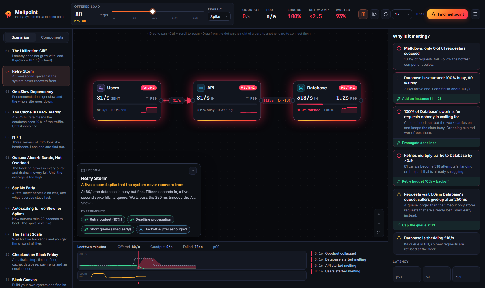
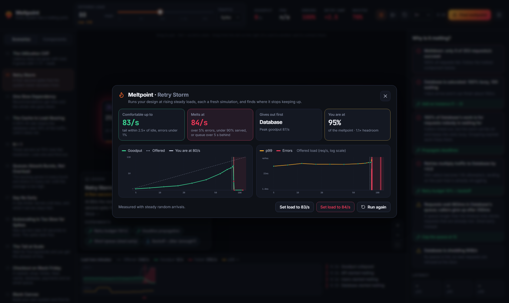

<p align="center">
  
</p>

<h3 align="center">Every system has a melting point. Find yours before production does.</h3>

<p align="center">
  <a href="https://morningstar-code.github.io/meltpoint/"><b>Open Meltpoint</b></a> ·
  <a href="README.es.md">Leer en español</a> ·
  <a href="#how-the-simulation-works">How it works</a> ·
  <a href="CONTRIBUTING.md">Contributing</a>
</p>

<p align="center">
  <a href="https://github.com/morningstar-code/meltpoint/actions/workflows/ci.yml"></a>
  <a href="LICENSE"></a>
  
  
</p>

Meltpoint is a distributed-systems simulator. Wire up clients, load balancers, services, caches,
databases, queues, rate limiters and circuit breakers, push the traffic up, and watch the system
heat up and melt: queues filling, timeouts firing, retries multiplying the load that caused them,
work piling up for callers that already gave up.

Then press **Find meltpoint** and it tells you the exact load where your design breaks, what gives
out first, and how much headroom you have left.

<p align="center">
  
</p>

## What makes it different

- **The meltpoint finder.** Instead of you dragging a slider until something turns red, Meltpoint
  runs your design at rising loads, each one a fresh simulation, bisects the edge, and reports the
  load you can carry comfortably, the load where it melts, the component that gives out first and
  your current headroom. Measured, not estimated.
- **"Why is it melting?"** A live, plain-language diagnosis: *"Retries multiply traffic to the
  database by ×3.9"*, *"62% of the database's work is for requests nobody is waiting for"*,
  *"Requests wait 1.2 s in the queue but callers give up after 250 ms"*. Most findings come with a
  one-click fix you can try immediately, and undo.
- **Wasted work is a first-class metric.** When a caller times out, the downstream keeps working
  on a request nobody wants any more. Meltpoint measures that waste on every component, because
  busy is not the same as useful.
- **Checked against queueing theory.** Select any component and the inspector compares the
  measured queueing delay with the Erlang C prediction for the same load. The test suite holds the
  engine to M/M/1 and M/M/c results.
- **A canvas that shows temperature.** Components run from cold blue to molten red as they fill
  up; melting ones glow and pulse. Requests travel the links as particles that turn red when they
  fail, and links show their retry amplification.
- **The fixes real systems use.** Exponential backoff with jitter, retry budgets, deadline
  propagation, load shedding, optional calls with fallbacks, circuit breakers, rate limiters,
  autoscaling with boot time, least-busy balancing, thread-per-request versus async I/O.
- **Chaos on demand.** Crash a component, slow it down 20×, make it fail a share of requests, or
  partition a link, and follow the failure as it travels.
- **Traffic with a shape.** Steady, daily wave, spikes, a ramp or bursts. Some failures, like the
  retry storm, only appear after a spike, and stay after it is gone.
- **An incident timeline.** Two minutes of offered load, goodput, failures and p99, with markers
  for the moments things melted, recovered, tripped or scaled.
- **Bilingual.** Every word of the interface and every lesson is available in English and Spanish.
- **Yours.** No account, no server, no tracking. Designs autosave in your browser, export to a
  file, or travel as a share link whose data lives in the URL fragment, which browsers never send
  to a server.

<p align="center">
  
</p>

Links can also carry a few options: `?lang=es` or `?lang=en`, `?theme=dark` or `?theme=light`,
`?t=30` to fast-forward the simulation 30 seconds, and `?open=meltpoint` to open the finder.

## Scenarios

Eleven guided scenarios, each a lesson with one-click experiments to try, break and fix things.

| Scenario | What it teaches |
| --- | --- |
| The Utilization Cliff | Latency grows with 1 / (1 − load), so the last 15% of capacity costs the most |
| Retry Storm | A five-second spike starts a storm that outlives it: a metastable failure |
| One Slow Dependency | A slow service is worse than a dead one: it holds every thread hostage |
| The Cache Is Load-Bearing | Lose some hit rate and the database gets traffic it was never sized for |
| N + 1 | Three servers at 70% look fine until one of them dies |
| Queues Absorb Bursts, Not Overload | A queue moves work in time; it does not create capacity |
| Say No Early | A rate limiter serves a bit less, and what it serves stays fast |
| Autoscaling Is Too Slow for Spikes | Servers that take 20 s to boot cannot help with a 5 s spike |
| The Tail at Scale | Wait for five backends and you get the slowest of five |
| Checkout on Black Friday | Every pattern at once, in a realistic shop |
| Blank Canvas | Build your own and find its meltpoint |

## How the simulation works

The engine in [`src/sim`](src/sim) is a discrete-event simulator with no UI dependencies. Every
request is an object that moves through the topology, and every number on screen is measured
from those objects.

- **Finite slots and real queues.** A component can work on `instances × slots` requests at once.
  The rest wait in a FIFO queue up to its limit, and beyond that they are shed.
- **Service times with variance.** Each request's service time is drawn from a gamma distribution
  with the mean and coefficient of variation you set. Variance is what pulls the tail away from the
  average, so it is modelled rather than assumed away.
- **Timeouts abandon, they do not cancel.** A caller that times out moves on (and maybe retries),
  but the downstream keeps working on the abandoned request. That is how retry storms happen, and
  why the *wasted work* metric exists. Turn on deadline propagation and components skip work that
  can no longer finish in time.
- **Retries are real attempts.** Each retry is a new request, with the backoff, jitter and retry
  budget of its link.
- **Blocking or async.** A service can hold its slot while it waits on downstream calls
  (thread-per-request) or release it (async I/O). This is the difference between a slow
  dependency being an inconvenience and it taking the whole service down.
- **Queues acknowledge immediately.** Producers get an answer at once; workers pull messages when
  they have a free slot, redeliver on failure and dead-letter after the maximum deliveries.
- **Percentiles are measured.** p50, p95 and p99 come from recent completed requests, never from a
  formula.
- **Deterministic.** The same design, load and seed replay identically.

The test suite checks that every request is accounted for, that the failure breakdown adds up,
that utilisation stays within bounds, that no number is ever NaN or infinite, that runs are
deterministic, and that the engine agrees with queueing theory.

## Run it locally

You need [Node.js](https://nodejs.org) 20.19 or newer.

```bash
git clone https://github.com/morningstar-code/meltpoint.git
cd meltpoint
npm install
npm run dev
```

Then open http://localhost:5173. `npm test` runs the test suite and `npm run build` makes a static
build in `dist/` that you can host anywhere.

```
src/sim/      the engine: events, components, scenarios, meltpoint finder, diagnosis. No DOM.
src/ui/       canvas, node cards, inspector, insights, timeline, meltpoint panel
src/i18n.ts   every interface string, in English and Spanish
src/App.tsx   the shell: state, undo, the animation loop, persistence and sharing
```

## Use the engine from code

The engine is plain TypeScript, so you can script experiments:

```ts
import { Engine } from './src/sim/engine';
import { scenarioById } from './src/sim/scenarios';
import { sweep } from './src/sim/sweep';

const storm = scenarioById('retry-storm')!;

const engine = new Engine(storm.topology, { seed: 42, load: 80, traffic: 'spike' });
engine.advance(60_000);
console.log(engine.snapshot().system); // goodput, p99, amplification, wasted work…

const result = sweep(storm.topology);
console.log(`safe up to ${result.safeLoad}/s, melts at ${result.meltLoad}/s`);
```

## Contributing

Bug reports, new scenarios, better explanations and translations are all welcome. Start with
[CONTRIBUTING.md](CONTRIBUTING.md). The one rule: the numbers have to be true. People learn from
this, so a plausible-looking number is worse than no number.

## Acknowledgements

Meltpoint was inspired by [Breakscale](https://github.com/workersio/breakscale), which showed how
much a live, honest simulation teaches compared with a static diagram. Meltpoint is an independent
implementation written from scratch.

## License

[MIT](LICENSE). The Inter and JetBrains Mono fonts are bundled from Fontsource under the SIL Open
Font License 1.1.
